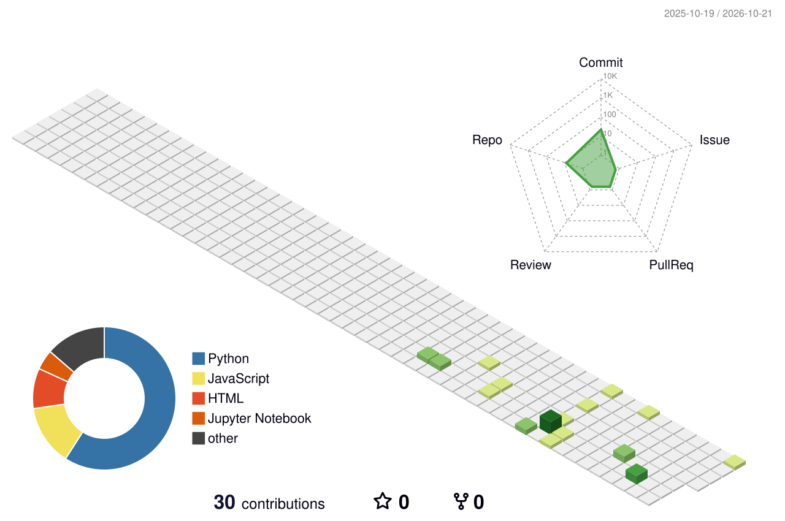

<div align="center">

# 👋 Hi, I'm Madaka Ganesh

### Building Software • AI • Data Analysis • Software Testing

<p>
  <a href="https://github.com/ganesh225329">
    
  </a>
  <a href="https://github.com/ganesh225329?tab=repositories">
    
  </a>
  <a href="mailto:madakaganesh53@gmail.com">
    
  </a>
</p>

📍 Bengaluru, Karnataka, India &nbsp;•&nbsp; 🕐 IST / GMT+05:30 (Asia/Kolkata)

</div>

---

## 👨‍💻 About Me

I'm **Madaka Ganesh**, a Computer Science & Engineering student focused on building practical technology solutions.

I enjoy working across:

- 💻 **Building Software** — Creating scalable, responsive, and functional applications.
- 🤖 **Artificial Intelligence** — Exploring AI systems, machine learning, and agentic workflows.
- 📊 **Data Analysis** — Extracting actionable insights from data with EDA and visualization.
- 🧪 **Software Testing** — Enhancing reliability through unit testing, functional verification, and test automation.

I like turning ideas into working applications, exploring AI technologies, finding useful insights from data, and improving software quality through testing and automation.

---

## 🎓 My College Journey

I started my B.Tech journey in **Computer Science and Engineering with a specialization in Artificial Intelligence & Machine Learning** at **Garden City University, Bangalore**.

Over the course of my degree, my interests have grown from programming fundamentals and software development into a broader journey across **AI, data analytics, and software testing**.

- 🏛️ **2023 — Foundations**  
  Started my B.Tech journey and built a strong foundation in programming, data structures, object-oriented programming, and core computer science fundamentals.

- 💻 **2024 — Building Software**  
  Started developing practical applications using Python, Java, C++, JavaScript, HTML, CSS, SQL, and MySQL.

- 📊 **2025 — Development & Data**  
  Expanded into web development, application development, data analysis, and visualization with Power BI, Tableau, Excel, Pandas, and NumPy.

- 🤖 **2026 — AI & Intelligent Systems**  
  Explored AI/ML, computer vision, TensorFlow, agentic AI, RAG, and modern AI development concepts through hands-on projects and experimentation.

- 🧪 **2026 — Software Quality**  
  Developed an interest in software testing and automation using JUnit, Selenium, Gradle, and GitHub-based development workflows.

- 🚀 **2026–2027 — Building & Learning**  
  Currently bringing these areas together to build practical software, autonomous AI solutions, data-driven applications, and reliable systems.

---

## 🧭 My Development Flow

```text
                 MY DEVELOPMENT JOURNEY

      SOFTWARE              AI / ML
          │                    │
          ▼                    ▼
     Web Development      Machine Learning
     Applications         Computer Vision
          │                    │
          └─────────┬──────────┘
                    │
                    ▼
              DATA ANALYSIS
                    │
                    ▼
             SOFTWARE TESTING
                    │
                    ▼
           RELIABLE SOFTWARE
```

### 🚀 My Direction

**Software Development → AI → Data Analytics → Software Testing**

I'm continuing to learn, build, test, and improve as I work toward becoming a versatile software engineer with an AI & ML focus.

---

## ⚡ What I Work With

### Programming & Development

<p>
  
  
  
  
  
</p>

### Web Technologies

<p>
  
  
  
  
  
</p>

### AI / Machine Learning

<p>
  
  
  
  
  
</p>

### Data & Visualization

<p>
  
  
  
  
</p>

### Testing & Tools

<p>
  
  
  
  
  
</p>

---

## 🚀 Featured Work

| Project | Description | Tech Stack |
|:---|:---|:---:|
| [**Cognifyz Technologies Internship**](https://github.com/ganesh225329/Cognifyz-Technologies-Internship) | Restaurant analytics, EDA, geospatial analysis, and rating prediction | `Python` `Pandas` `Scikit-learn` |
| [**Agentic AI**](https://github.com/ganesh225329/Agantic_AI) | Agentic AI architectures, multi-agent frameworks, and workflow automation | `Python` `Agentic AI` `LLMs` |
| [**Agentic AI Project**](https://github.com/ganesh225329/Agenticaiproject) | Practical agentic AI implementation and task orchestration | `Python` `AI` `LangChain` |
| [**Agentic AI Labs**](https://github.com/ganesh225329/Agenticailabs) | Hands-on experiments and prototyping with autonomous AI agents | `Python` `AI` `Agents` |
| [**Natural Gas Price Estimator**](https://github.com/ganesh225329/natural-gas-price-estimator) | Machine learning-based commodity price forecasting and evaluation | `Python` `ML` `Regression` |
| [**Software Testing**](https://github.com/ganesh225329/SoftwareTesting) | Comprehensive unit testing, automation suites, and QA workflows | `Java` `JUnit` `Gradle` `Selenium` |
| [**ToDoApp**](https://github.com/ganesh225329/ToDoApp) | Interactive web-based task management and productivity application | `JavaScript` `HTML5` `CSS3` |
| [**FSD Module 3**](https://github.com/ganesh225329/FSD_Module3) | Full-stack development modules, backend integration, and APIs | `JavaScript` `Node.js` `Web` |
| [**HTML Projects**](https://github.com/ganesh225329/Html-File) | Responsive web interfaces and semantic web design collections | `HTML5` `CSS3` |
| [**Java Core**](https://github.com/ganesh225329/java) | Core Java algorithms, data structures, and OOP implementations | `Java` `OOP` `Algorithms` |

> 💡 *Explore all repositories on my [GitHub Profile](https://github.com/ganesh225329?tab=repositories) for the complete collection.*

---

## 📌 Currently Focused On

```text
┌───────────────────────────────────────────────────┐
│                                                   │
│  💻 Software Development                          │
│  🤖 Artificial Intelligence                       │
│  📊 Data Analysis                                 │
│  🧪 Software Testing & Automation                 │
│                                                   │
└───────────────────────────────────────────────────┘
```

---

## 📈 GitHub Activity

<div align="center">


<br><br>


</div>

---

## 🐍 Contribution Snake

<div align="center">


</div>

---

## 🌆 Contribution Graph

<div align="center">



</div>

---

## 🔭 What I'm Building Toward

I want to keep growing as a developer by combining:

**Software Engineering + AI + Data + Testing**

The goal is to build solutions that are not only functional, but also useful, data-driven, intelligent, and reliable.

---

## 🤝 Connect With Me

<div align="center">

<a href="https://github.com/ganesh225329">
  
</a>
&nbsp;
<a href="mailto:madakaganesh53@gmail.com">
  
</a>

<br><br>

### 💡 Build. Learn. Test. Improve.


</div>
